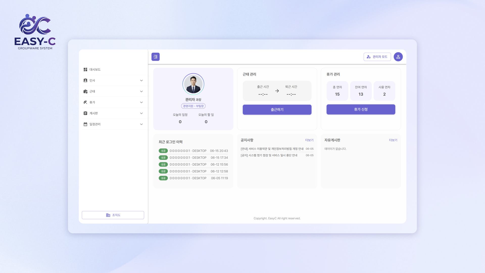
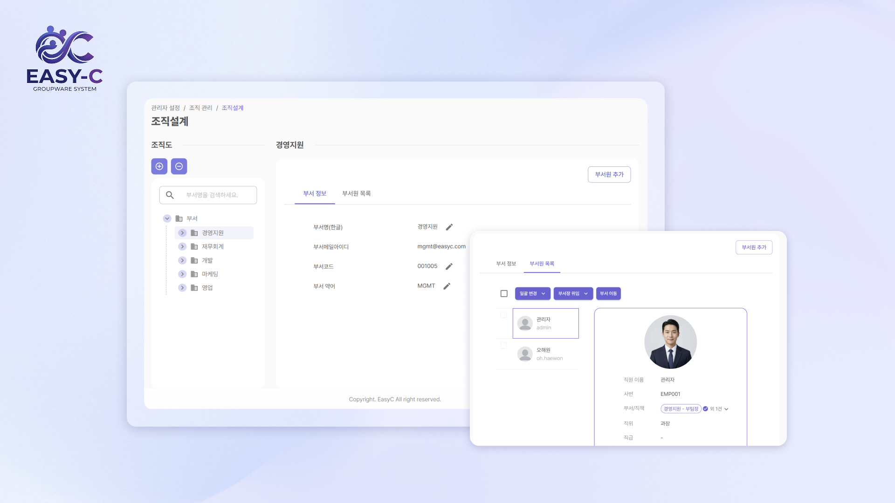
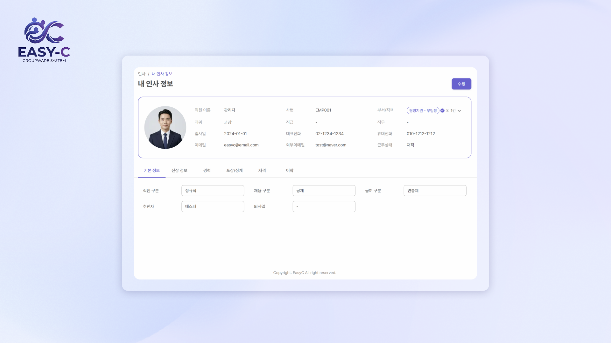
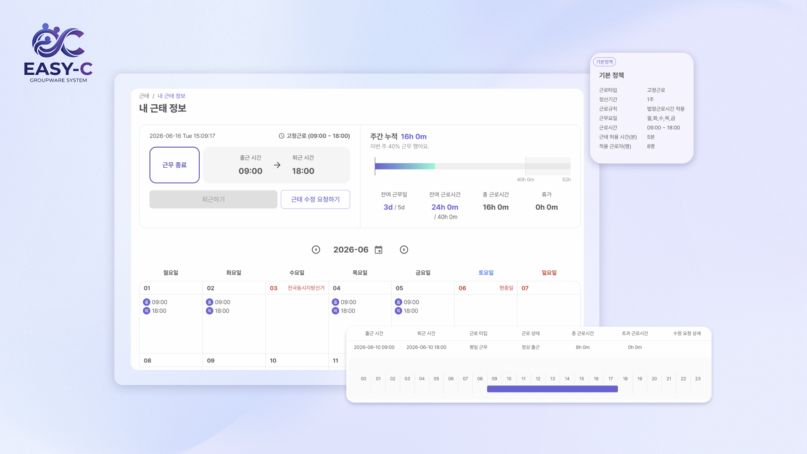
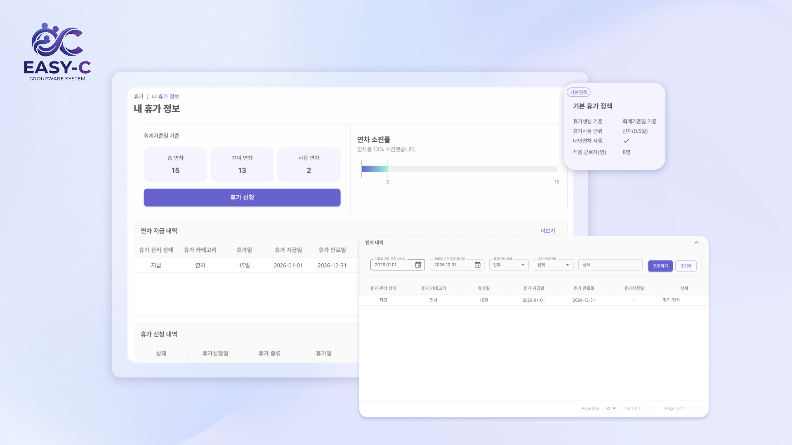
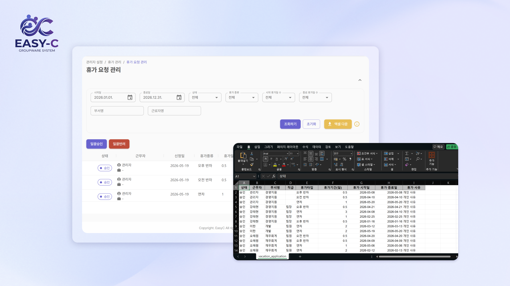
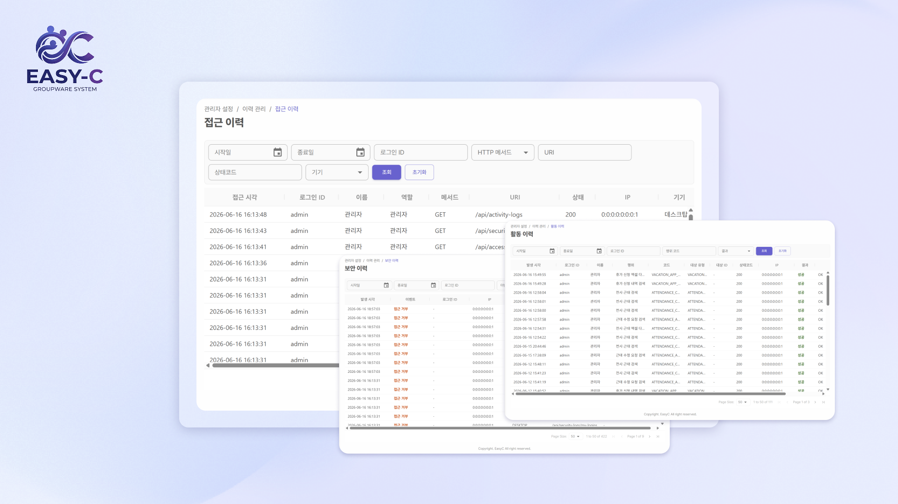

# 🏢 EASY-C (Groupware System)
**EASY-C**는 기업의 효율적인 자원 관리와 협업을 위해 설계된 차세대 그룹웨어 시스템입니다.  
Spring Boot와 Next.js의 최신 기능을 활용하여 견고한 백엔드 아키텍처와 반응형 UI를 제공합니다.

---

## ✨ Key Features

* **조직 설계 (Organization Design)**  
 `@minoru/react-dnd-treeview` 및 `MUI TreeView`를 활용한 직관적인 조직도 구성 및 관리
* **근태 및 휴가 관리 (Attendance & Leave)** 
 `react-calendar-timeline` 기반의 스케줄 관리 및 `dayjs`를 활용한 정밀한 시간 계산
* **회원 시스템 & 보안 (Auth & Security)** 
 Spring Security와 JWT(jjwt) 기반의 인증 체계 및 `jsencrypt`를 통한 클라이언트 보안 강화
* **감사 이력 및 데이터 관리 (Audit & Data)**  
 Spring AOP를 활용한 이력 추적 및 `Querydsl` 기반의 고성능 데이터 조회
* **고성능 게시판 (Board)** 
 `React Quill` 에디터 지원 및 `ag-grid`를 활용한 대용량 게시글 리스트 조회
* **데이터 시각화 및 리포트** 
 `Echarts`를 활용한 인사이트 대시보드 및 `EasyExcel` 기반의 대용량 데이터 엑셀 반출입

---

## 🛠 Tech Stack

### **Backend (Spring Boot)**

* **Framework**: Spring Boot 3.5.6 (Java 17)
* **Database**: PostgreSQL
* **ORM/Query**: Spring Data JPA & Querydsl 5.0 (Jakarta)
* **Security**: Spring Security & JWT (JSON Web Token)
* **Excel Library**: Alibaba EasyExcel (고성능 엑셀 처리)
* **Utility**: Lombok, Spring-Dotenv (환경 변수 관리), Hibernate Validator

### **Frontend (Next.js)**

* **Framework**: Next.js 15.1 (App Router)
* **State Management**: Zustand (경량화된 상태 관리)
* **UI Library**: Material UI (MUI) v7 & Emotion
* **Data Table**: AG-Grid (Enterprise급 데이터 그리드)
* **Form Management**: React Hook Form & Zod (타입 안정성 검증)
* **Chart**: Apache Echarts (반응형 차트)
* **Communication**: Axios (HTTP Client)

---

## 📝 Position

**진실**  
* 그룹웨어 기능 명세서 초안 작성 및 요구사항 정의 
* 관리자/사용자 화면의 기본 와이어프레임 설계 참여 
* 조직 및 인사 체계(부서·직급)의 트리 구조 기반 백엔드 설계 
* 조직도 및 부서 관리 기능 화면 구현 
* 관리자 모드(Admin) 주요 기능 개발 담당

**푸름**  
* 프로젝트 UI/UX 스타일 가이드 작성 
* 관리자/사용자 화면의 기본 와이어프레임 설계 참여 
* 근태 및 휴가 관리 시스템의 DB 모델링 및 백엔드 구조 설계 
* 근태 정책 기반 일정 관리 및 기간별 통계 차트 기능 구현
* 휴가 신청 프로세스 및 관련 비즈니스 로직 개발
* 개인 및 부서 단위 일정 캘린더 기능 구현

**민선**  
* 관리자 및 사용자 플로우 차트 설계
* 프로젝트 전체 ERD 설계 및 데이터 모델링
* Spring Security 기반 인증·인가 체계 구축, Refresh Token 관리
* 인사 정보 관리 DB 설계 및 관리 화면 구현
* 게시판 기능 설계 및 개발

---

## 🔍 Features Detail

### **조직관리**
 

**조직 설계 및 사원 관리** 
효율적인 조직 설계와 사원 관리를 위한 관리자 최적화
인터페이스

- 좌측 네비게이션을 통한 뎁스(Depth)별 무한 확장
- 부서별 소속 인원을 트리 구조 하위 노드로 직관적 표기
- 간편한 클릭만으로 부서 및 사원 간의 위계 파악 가능
- 조직 개편 시 실시간 반영되는 데이터 동기화 시스템
- 부서 생성, 수정, 삭제 및 부서원 관리 기능 통합 제공
- 부서 및 사원 등록 프로세스를 단일 화면 내에서 처리

### **인사관리**

**개인 인사정보** 
개인 인사 정보를 조회하고 관리할 수 있는 통합 인사 정보 인터페이스

- 사번, 부서, 직책, 직급, 입사일 등 기본 인사 정보 조회 지원
- 연락처, 이메일, 근무 상태 등 개인 프로필 정보 확인 가능
- 프로필 사진과 주요 인사 정보를 한 화면에서 확인 가능한 직관적 UI 구성
- 사용자 권한에 따른 인사 정보 수정 기능 지원
- 개인 경력 및 자격 정보를 체계적으로 관리할 수 있는 탭 기반 화면 제공

### **근태관리**

**실시간 근태 현황 관리** 
정확한 근무시간 집계와 근태 이력 관리를 위한 통합 근태 관리 인터페이스

- 근태 정책에 등록된 정산기간 기준 근무시간 자동 집계
- 출근·퇴근 버튼을 통한 실시간 근태 기록
- 주간 누적 근무시간, 잔여 근무시간, 휴가 현황 제공
- 근무 현황을 한 화면에서 확인 가능한 직관적 대시보드 구성
- 월간 캘린더를 통해 출퇴근 기록 및 근무 상태 조회

### **휴가관리**

**휴가 현황 관리** 
연차 지급 현황과 사용 내역을 한눈에 확인하고 간편하게 휴가를 신청할 수 있는 통합 휴가 관리 인터페이스

- 기준 총 연차, 사용 연차, 잔여 연차 현황 제공
- 연차 지급 내역 및 유효기간, 사용 현황을 직관적으로 확인
- 휴가 신청 기능을 통한 간편한 연차 신청 및 관리
- 잔여 휴가 현황과 사용 기록을 한 화면에서 확인 가능한 대시보드 구성

**휴가 요청 관리** 
휴가 신청 내역을 조회하고 승인·반려 처리할 수 있는 관리자용 휴가 요청 관리 인터페이스

- 휴가 신청 건에 대한 승인 및 반려 처리 기능 제공
- 신청 상태, 휴가 종류, 휴가 일수, 신청 기간 등 상세 정보 조회 지원
- 기간, 상태, 휴가 종류, 부서, 근로자 기준의 다양한 검색 및 필터 기능 제공
- 다수의 휴가 요청 건을 한 번에 처리할 수 있는 일괄 승인·반려 기능 지원
- 휴가 요청 관리 데이터를 엑셀 파일로 다운로드하여 활용 가능
- 향후 전자결재 시스템으로 고도화 필요

### **접근이력**
 
시스템 접속 및 페이지 접근 내역을 조회하여 사용자 활동을 추적할 수 있는 접근 이력 관리 인터페이스

- 사용자별 로그인 및 시스템 접근 기록 조회 지원
- 접근 시간, 사용자 ID, 접속 URL, 처리 상태 정보 제공
- 특정 기간, 사용자, URL 기준의 검색 및 필터 기능 지원
- 시스템 이용 현황 및 접근 패턴 모니터링 가능
- 비정상 접근 및 오류 발생 이력 확인 지원
- 접근이력, 보안이력, 활동이력 등의 이력 정보 개별 확인 가능

